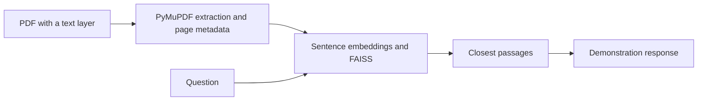

# CompanyBrain

A local PDF retrieval prototype. It extracts text with PyMuPDF, builds sentence embeddings, and retrieves passages with FAISS. The CLI prints page references for retrieved passages. The response generator returns a fixed demonstration response.

## Run locally

Use Python 3.11 or 3.12.

```bash
python -m venv .venv
. .venv/bin/activate
python -m pip install -r requirements.txt
python create_test_pdf.py
python main.py
```

On Windows PowerShell, activate the virtual environment with `.venv\Scripts\Activate.ps1`. The first run downloads the `all-MiniLM-L6-v2` model from Hugging Face.

The optional Streamlit application accepts a PDF and displays a demonstration response.

```bash
python -m streamlit run app.py --server.address 127.0.0.1
```



Use synthetic PDFs for evaluation. Scanned documents require OCR preprocessing. This project is intended for local use.
